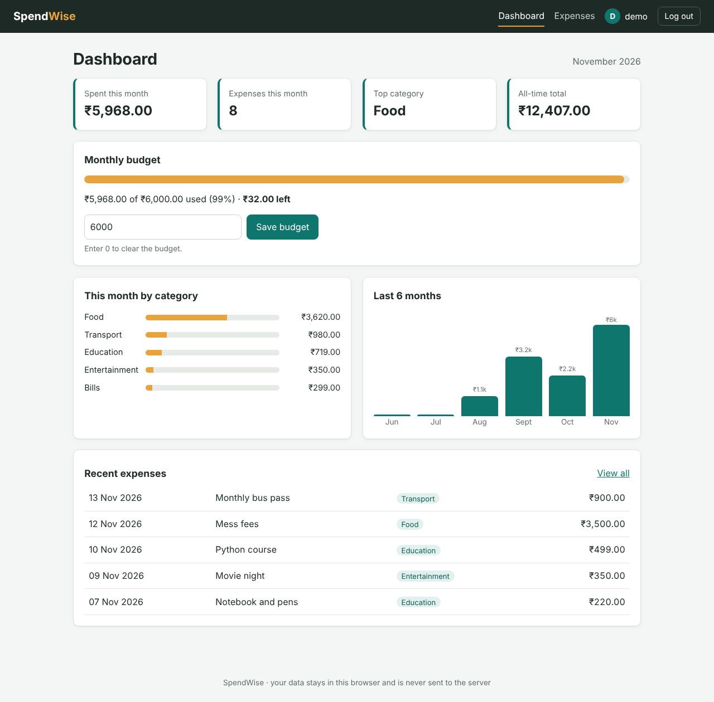
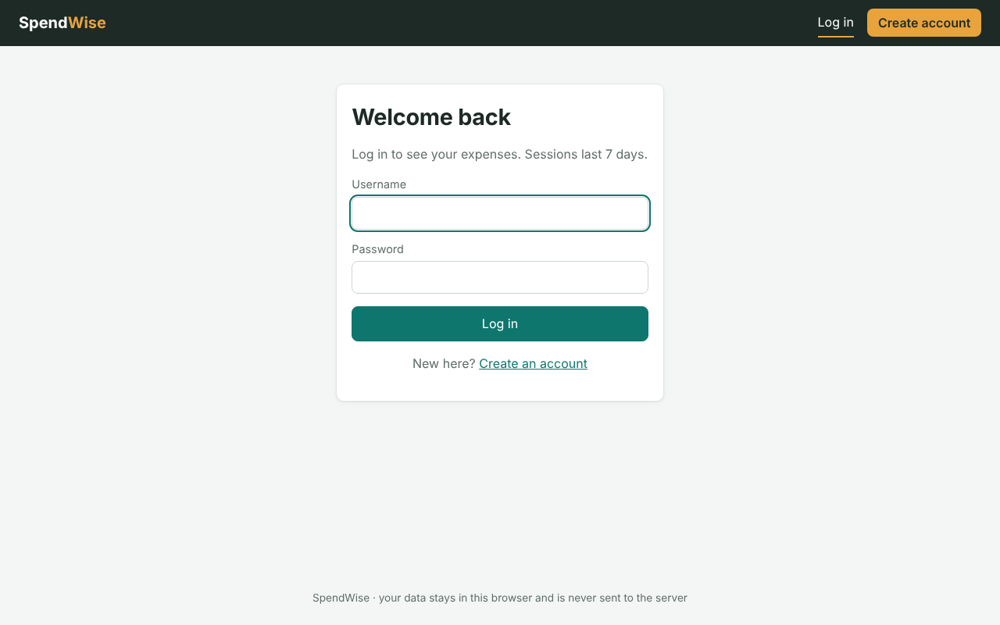
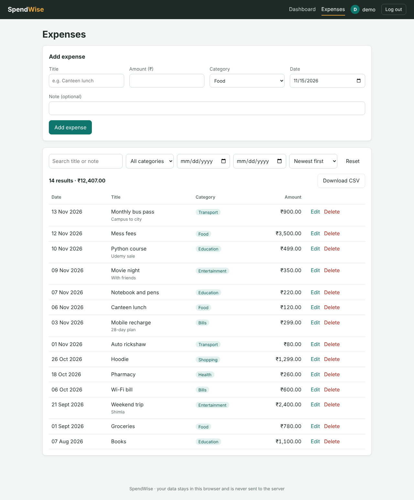
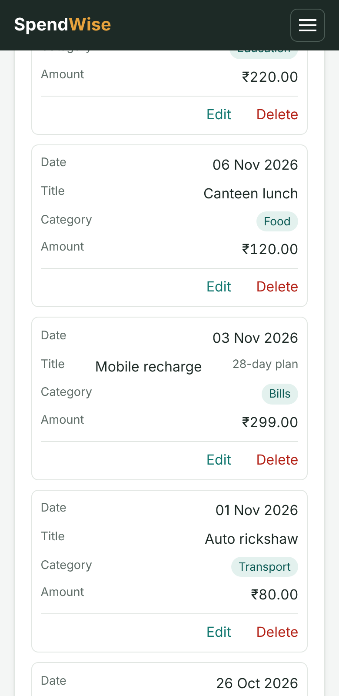

# SpendWise – Private Expense Tracker

SpendWise is a simple, professional expense tracker built with **Python + Flask**. You create an account, log your spending, set a monthly budget and see where your money goes, and **all of your data stays inside your own browser**. The Flask server only delivers web pages; it never receives, stores or processes any personal information.

> **Purpose:** students and early-career professionals lose track of small daily expenses. SpendWise gives a fast, private way to record spending and understand it, without cloud accounts or sync.



## Main features
- **Browser-only accounts**: register and log in with a username and password (PBKDF2 hashing via the Web Crypto API).
- **7-day sessions**: stay logged in for seven days, then log in again.
- **Progressive lockout**: 3 wrong passwords lock the account for 1 h, then 2 h, 4 h, 8 h, 16 h… (doubling).
- **Dashboard**: monthly total, expense count, top category, all-time total, budget progress with over-budget warning, category bars, six-month trend, recent expenses.
- **Expenses**: add, edit, delete with validation; search, category filter, date range, sort by date or amount.
- **CSV export** of the (filtered) list, **₹ Indian formatting**, notifications, empty/loading states, responsive layout (desktop, tablet, mobile).
- **Account isolation**: every account has its own expenses and budget.

## Technology stack
| Layer | Technology |
|---|---|
| Backend | Python 3.10+, Flask (serves pages and static files only) |
| Frontend | HTML (Jinja templates), CSS, vanilla JavaScript |
| Expenses and budgets | IndexedDB (in the browser) |
| Accounts, lockout, session | localStorage (in the browser) |
| Password hashing | Web Crypto API – PBKDF2-SHA256, random salt per account |

No database, no frontend framework, no external APIs, no third-party services.

## Installation
```bash
cd spendwise

# 1. Create a virtual environment
python -m venv venv

# 2. Activate it
venv\Scripts\activate            # Windows
source venv/bin/activate         # macOS / Linux

# 3. Install dependencies
pip install -r requirements.txt
```

## Run
```bash
python app.py
```
Open **http://127.0.0.1:5000** and click *Create an account*.

> The browser's Web Crypto API only works on `http://localhost`, `http://127.0.0.1` or `https://` addresses. Use one of those.

Optional environment variables (see `.env.example`): `HOST`, `PORT`, `FLASK_DEBUG` (set `FLASK_DEBUG=1` only for local development).

## Run the tests
```bash
python -m unittest discover -s tests -v          # server tests (no extra packages)
```
Browser tests exercise the real JavaScript in Chromium and are skipped if Playwright is missing:
```bash
pip install playwright && playwright install chromium
python -m unittest tests.test_browser -v
```

## Project structure
```
spendwise/
├── app.py                 # Flask: page routes + security headers (no data handling)
├── requirements.txt       # Flask (the only dependency)
├── .env.example           # optional environment variables
├── templates/             # base, index, login, register, dashboard, expenses, 404
├── public/                # static files (served at the site root; Vercel serves public/ from its CDN)
│   ├── css/style.css
│   ├── js/auth.js         # accounts, PBKDF2, 7-day session, lockout (localStorage)
│   ├── js/storage.js      # IndexedDB expenses/budgets + validation
│   ├── js/script.js       # shared UI: session guard, nav, toasts, formatting
│   ├── js/auth-pages.js   # login / register forms
│   ├── js/dashboard.js    # dashboard page
│   ├── js/expenses.js     # expenses page (CRUD, filters, CSV)
│   └── images/            # favicon and screenshots
├── docs/                  # detailed documentation (see below)
└── tests/                 # test_app.py (Flask), test_browser.py (Playwright)
```

## Documentation
| File | Contents |
|---|---|
| [docs/PROJECT_OVERVIEW.md](docs/PROJECT_OVERVIEW.md) | What it does, the problem, users |
| [docs/FEATURES.md](docs/FEATURES.md) | Every feature explained |
| [docs/ARCHITECTURE.md](docs/ARCHITECTURE.md) | How Flask, HTML, CSS and JS fit together |
| [docs/AUTHENTICATION.md](docs/AUTHENTICATION.md) | Registration, hashing, sessions, lockout |
| [docs/DATA_STORAGE.md](docs/DATA_STORAGE.md) | What is stored where |
| [docs/DEPLOYMENT.md](docs/DEPLOYMENT.md) | GitHub and hosting |

## Screenshots
| Login | Expenses | Mobile |
|---|---|---|
|  |  |  |

## Upload to GitHub
```bash
cd spendwise
git init
git add .
git commit -m "SpendWise: Flask expense tracker with browser-local storage"
git branch -M main
git remote add origin https://github.com/<your-username>/spendwise.git
git push -u origin main
```
Create the empty repository on github.com first (no README/licence). The `.gitignore` already excludes virtual environments, `.env` and caches. There is no user data in this project to leak.

## Deployment (Vercel, with the code on GitHub)
GitHub stores your code; **GitHub Pages cannot run Flask**, so the app is hosted on Vercel's Python runtime, which runs Flask directly.

1. Push the project to GitHub (see above).
2. On vercel.com choose **Add New → Project**, import the GitHub repository and click **Deploy**. Vercel detects the Flask `app` in `app.py` and installs `requirements.txt` automatically. No build command, start command, `vercel.json` or environment variables are needed.
3. Open the `https://…vercel.app` URL (HTTPS is required for password hashing).

Static files live in `public/` because Vercel serves that folder from its CDN and ignores Flask's own static folder. Locally Flask serves the same folder, so the URLs are identical. Other Python hosts (Render, Railway…) also work: use `pip install gunicorn` and the start command `gunicorn app:app`. Full steps: [docs/DEPLOYMENT.md](docs/DEPLOYMENT.md).

## Browser storage explained
- **IndexedDB** holds expenses and budgets (each record tagged with the owner's `userId`).
- **localStorage** holds the account list (username, salt, password hash, failed-attempt counter, lockout time) and the current session (with its expiry time).
- CSV export creates the file in your browser; nothing is uploaded.

Details: [docs/DATA_STORAGE.md](docs/DATA_STORAGE.md).

## Privacy and limitations (please read)
This is **browser-local authentication for personal use on one browser and device. It is not a secure online account system**, and it is not enterprise-grade.

- Anyone who can open your browser profile and its developer tools can read, change or delete the stored data, including the account records and lockout counters. Lockout and sessions protect against casual access, not against someone controlling the browser.
- **Clearing browser data (cookies/site data) permanently deletes accounts and expenses.** Export CSV backups regularly.
- Data does **not** sync across devices or browsers, and a different browser has its own separate accounts.
- There is **no password recovery**: a forgotten password means that account's data cannot be opened.
- Lockout timing uses the device clock; changing the system clock changes timing.
- Passwords are never sent to Flask or any third party and are stored only as salted PBKDF2 hashes. Expense data is not encrypted at rest in IndexedDB.
